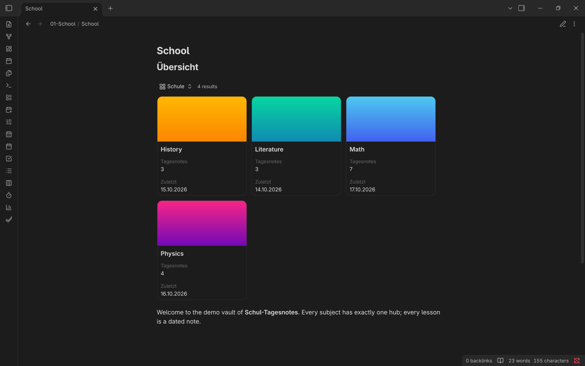
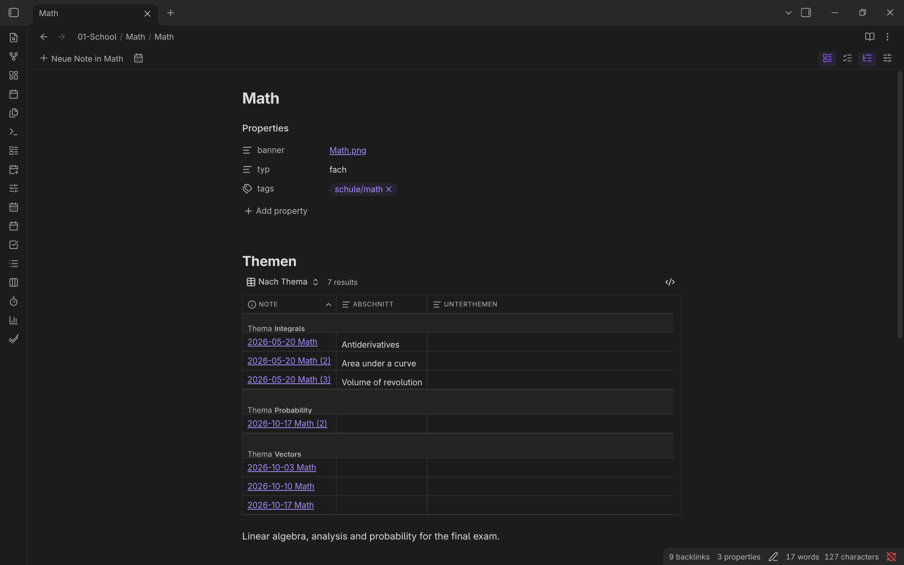
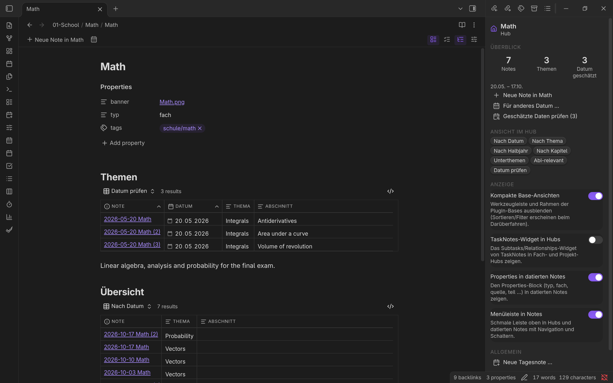
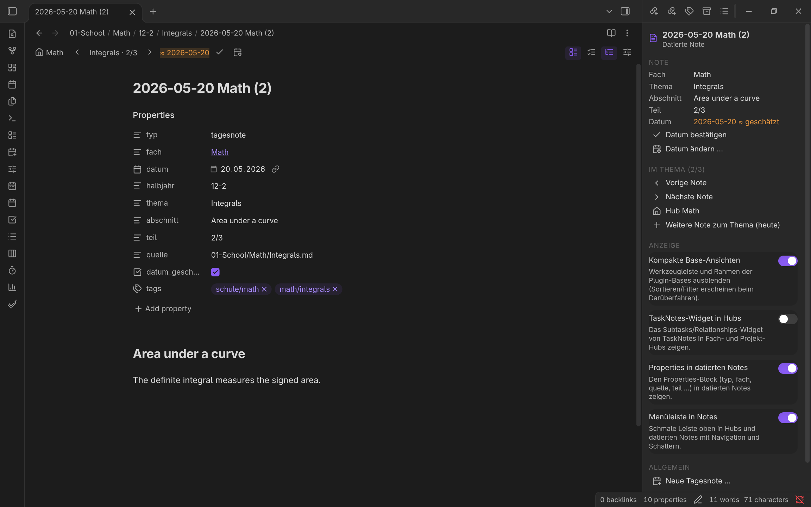
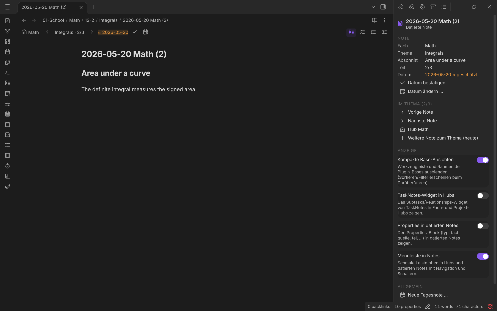
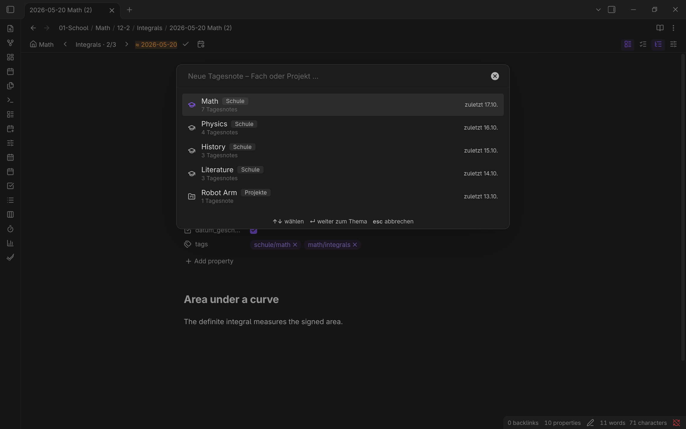
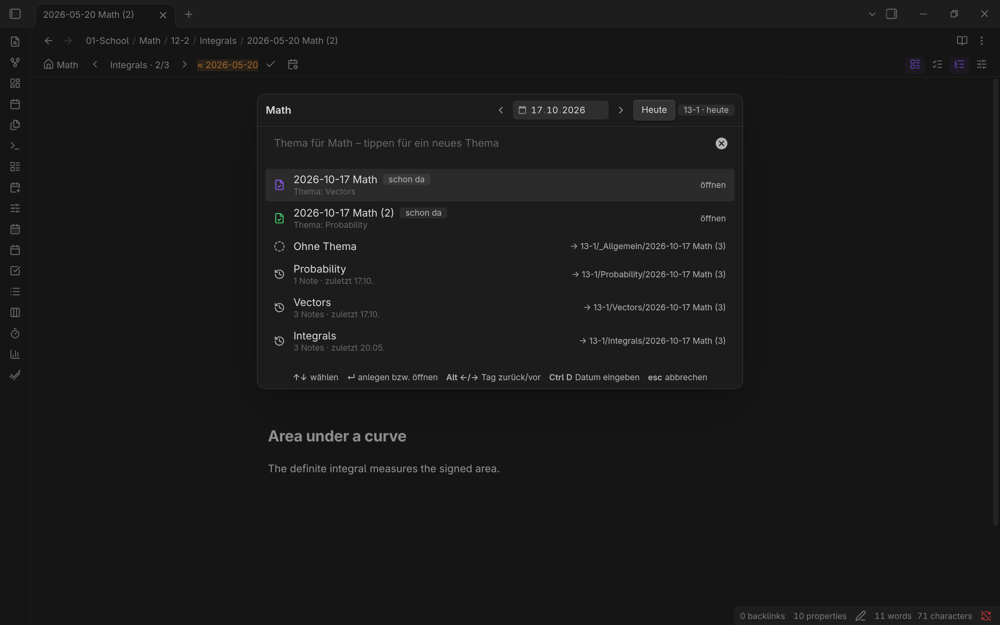
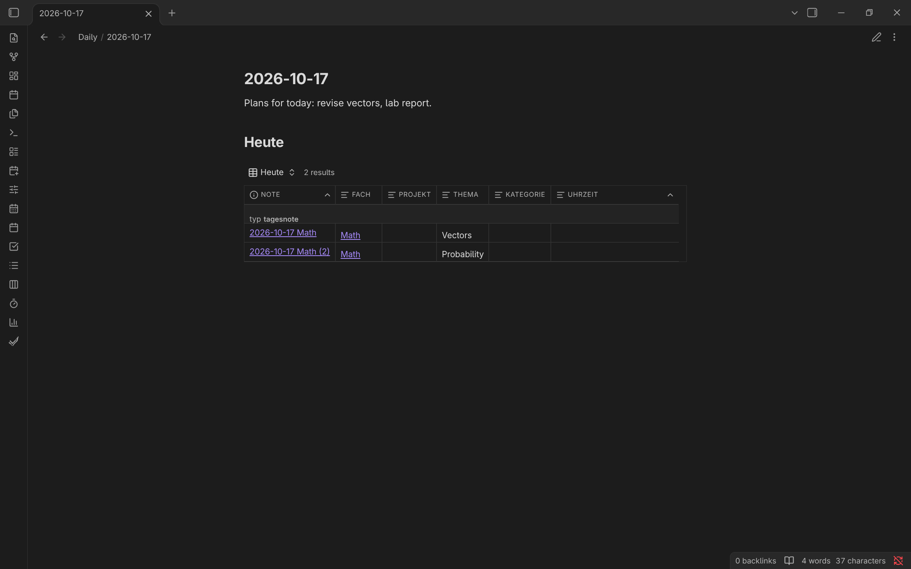
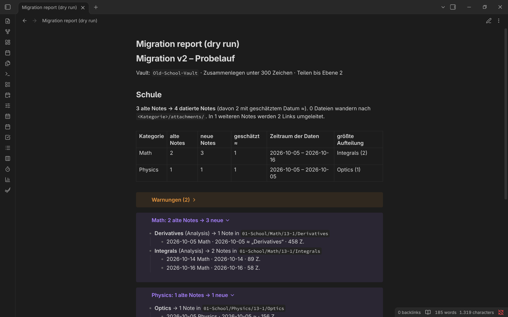

# Schul-Tagesnotes

An [Obsidian](https://obsidian.md) plugin for **dated notes per subject**. Instead of a single note per topic that keeps growing, you write a fresh dated note for every lesson. The plugin creates the note, files it into `subject / term / topic`, keeps its tags in sync and gives every subject **one hub** with [Bases](https://help.obsidian.md/bases) views over all its notes.

```
01-Schule/<Subject>/<Term>/<Topic>/<YYYY-MM-DD> <Subject>[ (n)].md
```

> The plugin's interface (commands, dialogs, settings) is in **German**, and the defaults fit a German upper school (Bavarian G9, terms `12-1` … `13-2`). Everything, including subjects, terms, folders and templates, can be changed in the settings. Command names below are given in German with a translation.

## Features

- **Dated notes per subject.** Pick a subject, then a topic. The note is created in the right folder with properties and tags already set. The same subject and topic on the same day opens the existing note; another topic on the same day gets a second note `… (2)`.
- **Automatic filing.** If you change `thema` (topic), `datum` (date) or `fach` (subject), the note moves to its new folder about a second later. Tags and term follow, and empty folders are removed.
- **One hub per subject.** There are no separate topic notes; the topic is a property.
  - The subject hub shows all notes by date, term, topic or former chapter, plus subtopics, an "exam-relevant" view and "check dates" for estimated dates.
  - The area hub (e.g. `Schule.md`) shows one card per subject with its banner, number of notes and last lesson.
- **Several areas.** School subjects (with terms) and personal projects (with years as the period) work the same way.
- **Attachments.** Images pasted into a daily note are collected in `<Subject>/attachments/<Term>/` instead of one folder per topic.
- **Journal.** Dated journal notes (scratchpad, to-dos, notes, day plans), a pinned scratchpad with an "archive" button and a day overview for the Calendar plugin.
- **Tasks.** Open checkboxes become [TaskNotes](https://github.com/callumalpass/tasknotes) tasks. The status is synced both ways.
- **Clean-up tools.** Each one shows a dry run before changing anything:
  - migrate an existing topic-based vault: every note becomes dated notes, split at `#`/`##` headings and date markers, with links redirected,
  - unify inline tags (`stichwort/`, `person/`, `markierung/`),
  - link glossary terms and people,
  - replace hand-written link lists with Bases views.
- **Control panel and toolbar.**
  - A side panel (like Advanced Tables) follows the active note: stats, navigation within a topic, confirming or changing estimated dates, display toggles.
  - A slim toolbar sits on top of hubs and dated notes.
- **Display toggles.** Compact Bases views, the TaskNotes widget in hubs, the properties block in dated notes and the toolbar can each be switched on and off (panel, settings or command).

## Tour

The screenshots come from a demo vault with invented content (`node scripts/demo-vault.ts <folder>`). The interface is German; the captions explain what you see.

### 1. Overview: one card per subject



The area hub (`School.md`) embeds `![[Bereich.base#Schule]]`. Each card shows:
- the subject's banner,
- the number of dated notes (*Tagesnotes*),
- the date of the last one (*Zuletzt*).

A click opens the subject hub.

### 2. One hub per subject



The subject hub is the only hub of a subject. On top, the view **Nach Thema** groups all notes by topic, oldest first. The parts of a former topic note (*Abschnitt*) stay in order.

The toolbar above the note offers:
- **Neue Note in Math** (new note in this subject),
- a note for another date,
- the display toggles,
- the control panel.

Switch views with the dropdown: by date, term, topic, chapter, subtopics, exam-relevant, check dates, glossary terms.

### 3. Check estimated dates – with the control panel



**Datum prüfen** lists the notes whose date was estimated from the file during the migration.

The **control panel** (ribbon icon *sliders* or command „Schul-Panel öffnen“) follows the active note. For a hub it shows:
- the number of notes, topics and estimated dates,
- buttons for new notes,
- chips that switch the hub's view,
- the display toggles.

### 4. A dated note



Every lesson is a note named `<date> <subject>`. Further notes on the same day get ` (2)`, ` (3)` …

The toolbar shows:
- the hub,
- the position within the topic (*Integrals · 2/3*) with previous/next,
- the estimated date (≈) with buttons to **confirm** or **change** it. After a change the note moves to the matching term folder.

### 5. Less clutter: hide the properties



With **Properties in datierten Notes** switched off, dated notes show only their content. The other toggles hide the TaskNotes widget in hubs (off by default) and the Bases toolbar (compact mode).

### 6. Writing in class: new dated note



*Ctrl+Alt+N* (or the ribbon icon) opens the dialog.

**Step 1:** choose the subject. Recently used subjects come first, each with its area, number of notes and last date.



**Step 2:** choose the date and the topic.
- **Date:** today by default. *Alt+←/→* moves by a day, *Ctrl+D* lets you type a date.
- **Schon da** (already there): the notes that already exist for that day. Selecting one opens it.
- **Topic:** the same topic opens its note; a new topic (just type) creates `… (3)`. The target folder and name are shown on the right.

### 7. Calendar: everything of one day



The daily note (Calendar plugin or *Daily notes*) embeds `![[Tag.base]]`. It lists all dated notes and journal notes of that day.

### 8. Migrating an existing vault



The dry run (`node scripts/probelauf2.ts <vault> report.md`) reads an old topic-based vault without changing it. It shows, for every old note, the dated notes it will become, plus warnings and redirected links. The migration then runs in Obsidian, one confirmed step at a time. See [docs/MIGRATION.md](docs/MIGRATION.md).

## Installation (BRAT)

The plugin is not in the community plugin list. Install it with [BRAT](https://github.com/TfTHacker/obsidian42-brat):

1. Install and enable **Obsidian42 - BRAT** from the community plugins.
2. *Settings → BRAT → Add Beta plugin* and enter `schildi208-lgtm/obsidian-schul-tagesnotes`.
3. Enable **Schul-Tagesnotes** under *Settings → Community plugins*.

BRAT checks for new releases on startup, or on demand with *BRAT: Check for updates*.

Manual installation: download `main.js`, `manifest.json` and `styles.css` from the [latest release](../../releases/latest) into `<vault>/.obsidian/plugins/schul-tagesnotes/`.

**Requirements:** Obsidian 1.9 or newer (Bases). Works on desktop and mobile; migrations are desktop-only.

## Quick start

1. *Settings → Schul-Tagesnotes*: check subjects (`Name | Folder | tag`), terms (`Name | Start | End`) and folders.
2. Command palette → **„Templates und Base im Vault anlegen“** (*create templates and bases*). This only creates missing files.
3. Optionally assign a hotkey to **„Neue Tagesnote …“** (*new daily note*), e.g. `Ctrl+Alt+N`.
4. Write: **„Neue Tagesnote …“** → choose a subject → choose or type a topic.

If you already have a vault organised by topic, read [docs/MIGRATION.md](docs/MIGRATION.md) first.

## Documentation

| Document | Content |
|---|---|
| [docs/USER-GUIDE.md](docs/USER-GUIDE.md) | Daily use, hubs and views, all commands, properties, folder layout |
| [docs/MIGRATION.md](docs/MIGRATION.md) | Converting an existing vault step by step, dry runs, backups, undo |
| [docs/ARCHITECTURE.md](docs/ARCHITECTURE.md) | Modules, data flow, configuration model |
| [docs/DEVELOPMENT.md](docs/DEVELOPMENT.md) | Building, testing, local development, releases |
| [CHANGELOG.md](CHANGELOG.md) | Version history |

## Safety

- The plugin never deletes notes; it only removes folders that became empty.
- Notes without the plugin's properties (`typ: tagesnote | thema | journal` plus subject/project) are never touched by the automatic filing.
- Every bulk command (migration, tags, terms, link lists, bases) shows what will change and asks for confirmation. **Make a backup or Git commit first.**

## License

[MIT](LICENSE) © Nyxel
